# Smart Heating Control

[English](README.md) | [Română](README.ro.md) | [Deutsch](README.de.md) | [Nederlands](README.nl.md) | [Français](README.fr.md) | [Italiano](README.it.md) | **Español**

[](https://hacs.xyz/)
[](https://github.com/sandreialexandru/Smart-Heating-Control/actions/workflows/validate.yml)
[](https://github.com/sandreialexandru/Smart-Heating-Control/actions/workflows/tests.yml)

**¿Te gusta Smart Heating Control? Apoya su desarrollo:**

<a href="https://ko-fi.com/sandreialexandru"></a>

**Una calefacción para Home Assistant que sabe quién está en casa, aprende
cómo se calienta cada habitación y te dice por qué hace lo que hace.**

Calor cuando vuelves, más fresco cuando no hay nadie, nada de calor perdido
por una ventana abierta y ninguna regla que escribir. Funciona con lo que ya
tienes: Generic Thermostat, válvulas termostáticas, termostatos inteligentes o
un simple relé.

<p align="center"><a href="https://github.com/user-attachments/assets/31181198-e0fa-4510-bbfa-af9f790a19c7">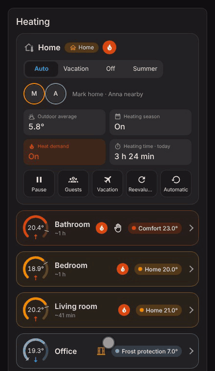</a></p>

<p align="center"><sub>La tarjeta en uso · personas y datos inventados · <a href="https://github.com/user-attachments/assets/31181198-e0fa-4510-bbfa-af9f790a19c7">el vídeo en mejor calidad</a></sub></p>

## Qué hace

**Sabe quién está en casa.** Cada persona está *en casa*, *cerca* (en algún
lugar de tu ciudad) o *lejos*. La casa calienta para quien está, se queda en
*eco* mientras solo estáis cerca, pasa a *away* cuando todos están lejos y,
con Proximidad (recomendado, con la dirección) o un sensor de tiempo de
viaje, vuelve a calentar cuando alguien viene de camino.

**Aprende sola cada habitación.** Cada habitación aprende lo rápido que se
calienta, cómo se enfría, lo lento que reaccionan los radiadores o el suelo
radiante, cuánto más da una caldera con curva climática cuando hace frío y,
con una entidad del tiempo, cuánto la calienta el sol. Después empieza a
calentar justo a tiempo para estar caliente a la hora, y para antes cuando la
habitación va a seguir confortable de todos modos. Nada que ajustar: a una
habitación le basta más o menos un día, 4 horas con calefacción y 4 sin ella.

**Programas a la medida de tu semana.** Perfiles para los días laborables, el
fin de semana, días concretos o los festivos (de la integración Workday), un
calendario que elige el perfil de un día, o un ayudante Horario que ya
tengas. Se editan en la tarjeta arrastrando las horas.

**Ventanas abiertas y cambios a mano, resueltos.** Un sensor de ventana o una
bajada brusca de la temperatura baja la calefacción; las habitaciones vecinas
pueden seguirla. Si giras un termostato a mano, el cambio se mantiene el tiempo
que hayas elegido y luego vuelve el programa.

**Atenta al tiempo.** Apaga la calefacción cuando fuera hace calor (también
según la previsión), maneja una temporada de calefacción, añade calor con las
heladas fuertes y baja una habitación al sol.

**Energía.** Enciende la caldera solo cuando una habitación lo necesita, sigue
una tarifa dinámica o el excedente solar, pasa a una segunda fuente de calor
(la bomba de calor mientras hay sol, la caldera con las heladas fuertes) y
cuenta el tiempo de calefacción por día, semana o mes.

**Segura.** Siempre la protección antiheladas, una temperatura máxima, cada
orden comprobada y reenviada si no ha llegado, alertas por ventanas abiertas,
dispositivos no disponibles, baterías bajas y **riesgo de moho** en la pared
más fría, y un antibloqueo semanal de las válvulas termostáticas.

**Se explica sola.** Cada habitación tiene un sensor *Decisión* con la regla
que ha ganado y el motivo, un evento en cada cambio y un diagnóstico con las
últimas 100 decisiones.

**Se adapta a tu casa.** Generic Thermostat (solo se elige el preajuste; tu
termostato sigue funcionando como antes), válvulas termostáticas calibradas
con un sensor de la habitación, otros termostatos, relés. °C o °F por casa. En
español, inglés, rumano, alemán, neerlandés, francés e italiano.

## La tarjeta

Con la integración llega una tarjeta Lovelace, que se añade sola a los
recursos del panel de control.

<table>
  <tr>
    <td align="center" width="50%">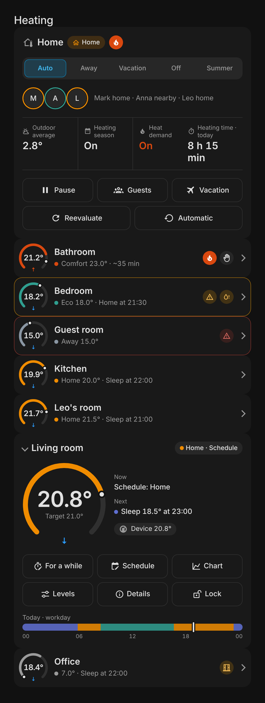<br><sub>La casa y sus habitaciones</sub></td>
    <td align="center" width="50%">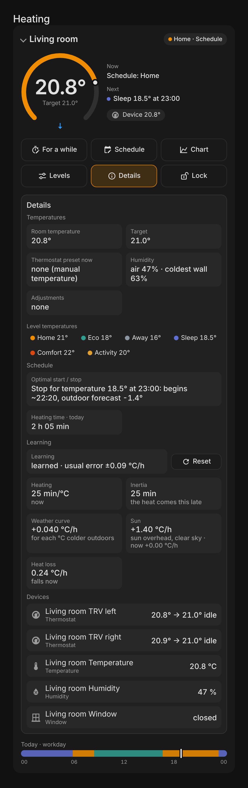<br><sub>Lo que ha aprendido una habitación</sub></td>
  </tr>
  <tr>
    <td colspan="2" align="center">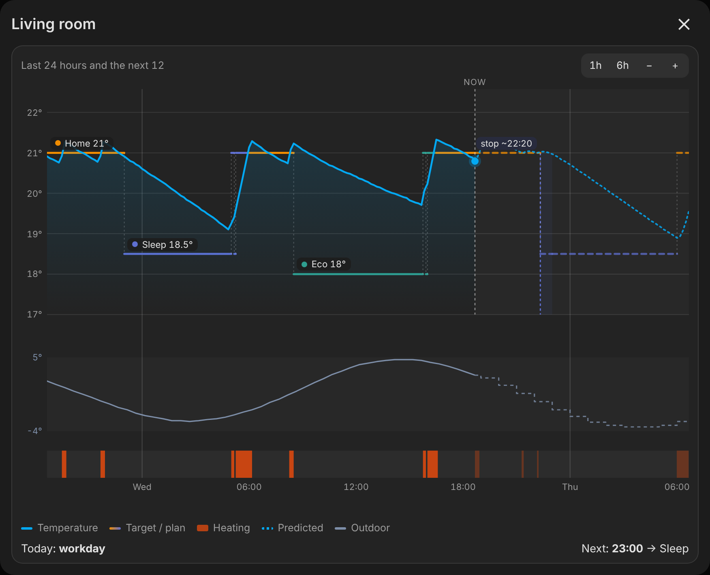<br><sub>7 días de historial y las próximas 12 horas, con la temperatura que la habitación espera</sub></td>
  </tr>
  <tr>
    <td align="center">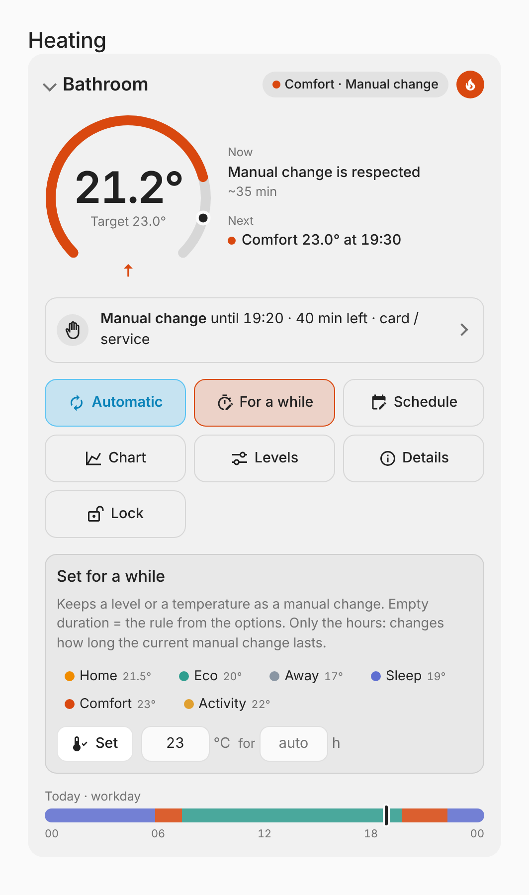<br><sub>Fijar un nivel o una temperatura por un tiempo</sub></td>
    <td align="center">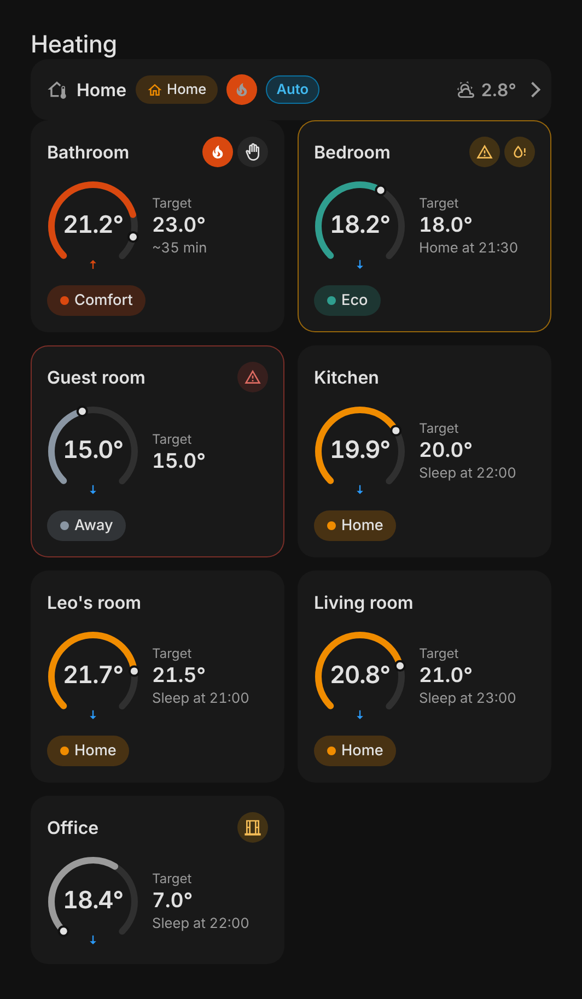<br><sub>Compacta: un mosaico por habitación</sub></td>
  </tr>
</table>

```yaml
type: custom:smart-heating-control-card
```

Cada parte se puede ocultar; las opciones están en la
[guía](docs/guide/10-card.md) (en inglés).

## El panel

Una página propia en la barra lateral, **SHC**, para todos los usuarios: toda
la casa en una pantalla, el programa de todas las habitaciones para la semana
que viene (copiado a otras habitaciones con un toque), estadísticas (tiempo de
calefacción y temperaturas por día, semana o mes, y cuándo calienta cada
habitación, hora a hora), el historial de las decisiones y las alertas con las
alertas activas arriba, la humedad de las habitaciones con el riesgo de moho y
todos los dispositivos de las habitaciones con su batería. Nada que
configurar; los detalles están en la [guía](docs/guide/13-panel.md) (en
inglés).

<table>
  <tr>
    <td colspan="2" align="center">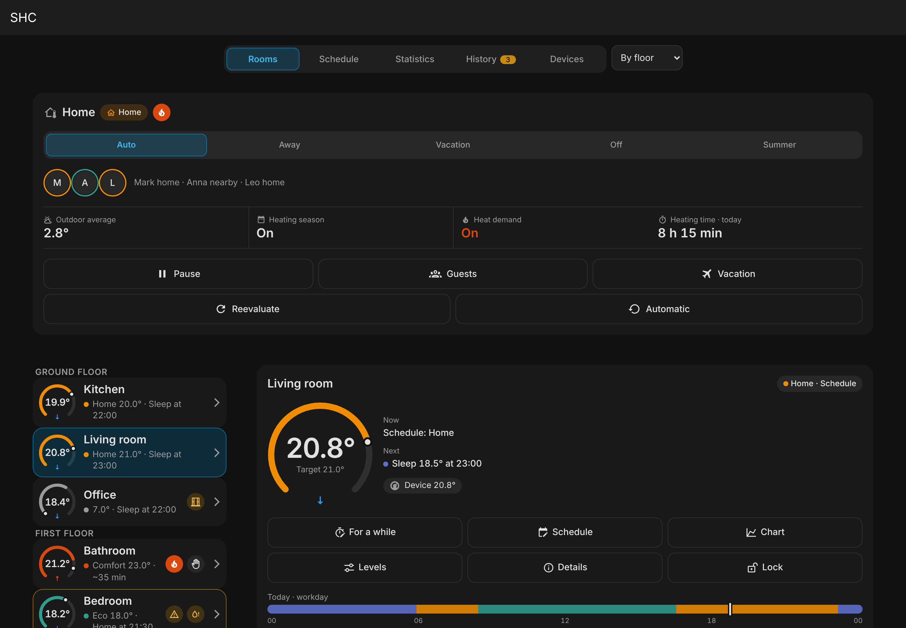<br><sub>Toda la casa en una pantalla, las habitaciones por planta</sub></td>
  </tr>
  <tr>
    <td align="center" width="50%">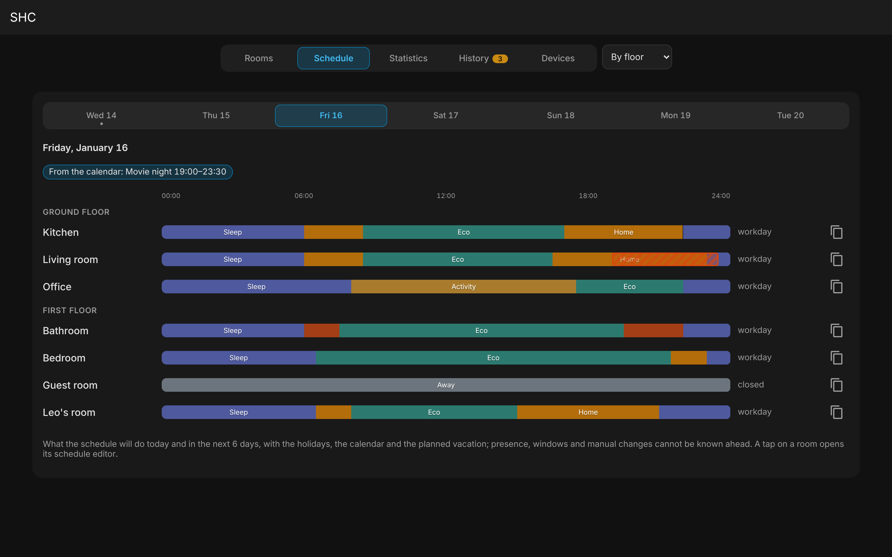<br><sub>La semana que viene de cada habitación, con el calendario</sub></td>
    <td align="center" width="50%">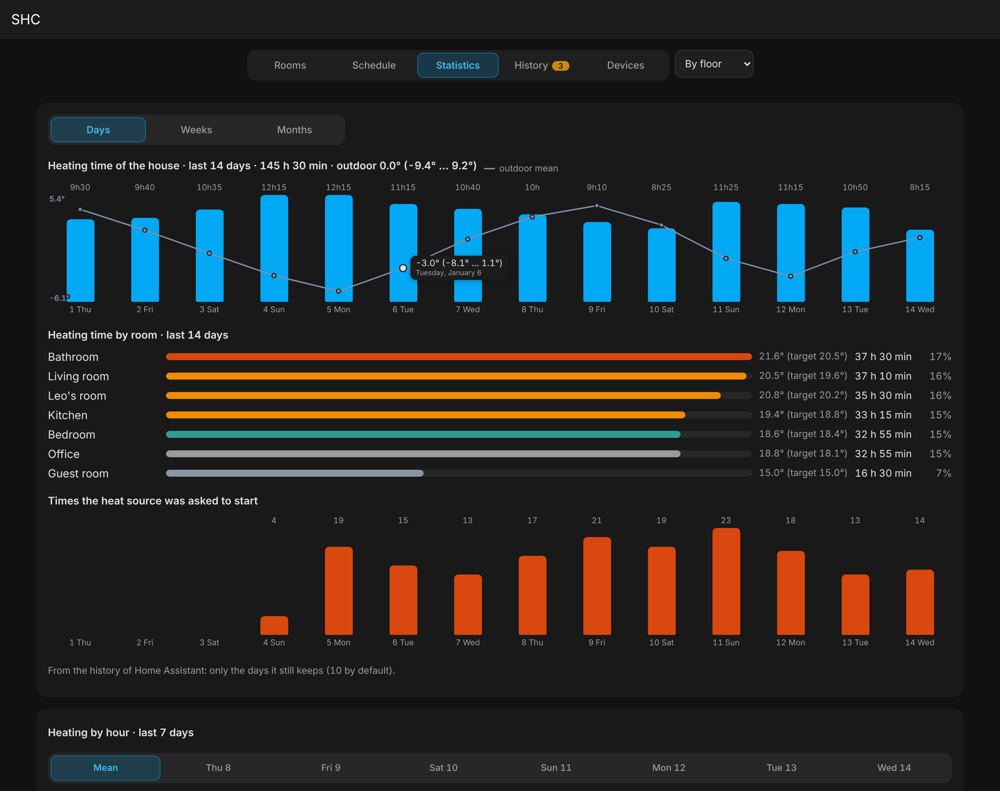<br><sub>El tiempo de calefacción frente a la temperatura exterior</sub></td>
  </tr>
  <tr>
    <td align="center">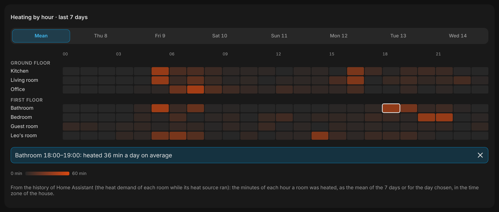<br><sub>Cuándo calienta cada habitación, hora a hora</sub></td>
    <td align="center">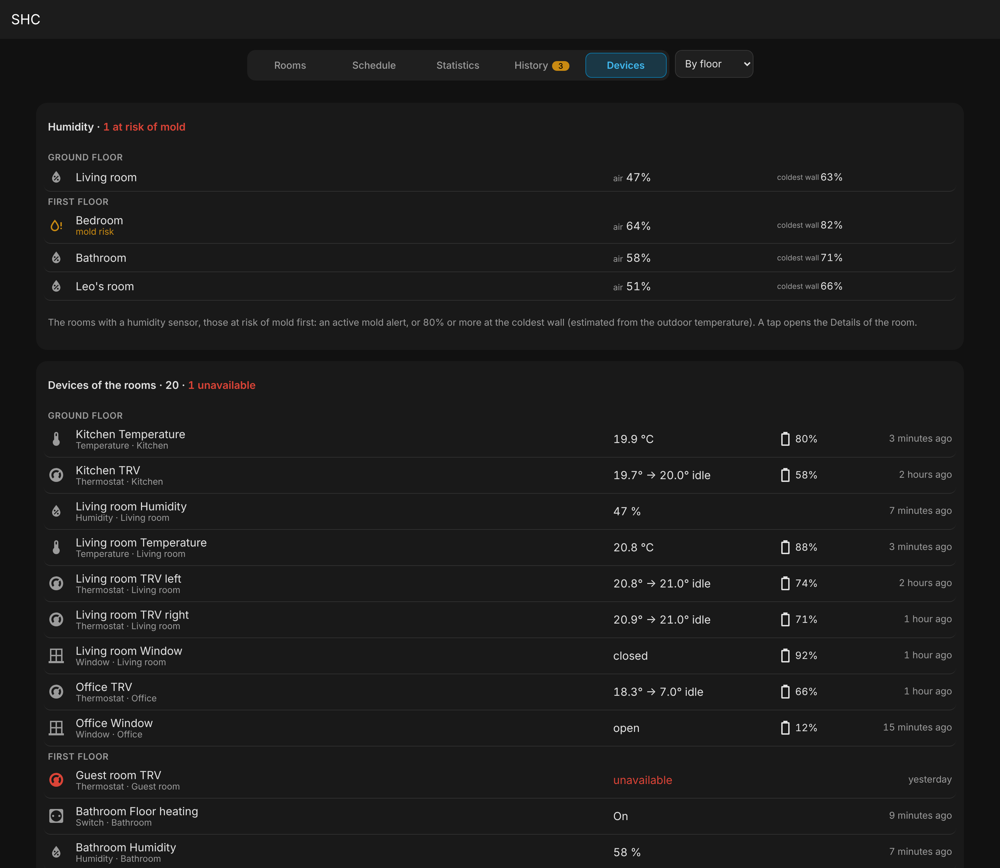<br><sub>Humedad y riesgo de moho, cada dispositivo con su batería</sub></td>
  </tr>
</table>

<table>
  <tr>
    <td align="center" width="25%">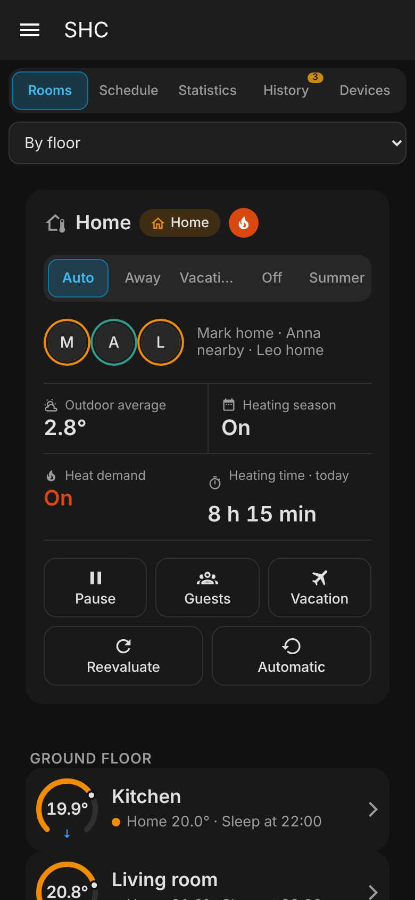</td>
    <td align="center" width="25%">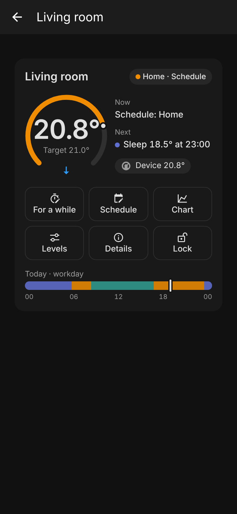</td>
    <td align="center" width="25%">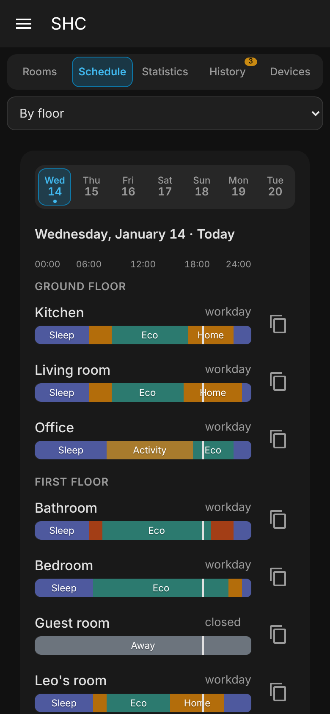</td>
    <td align="center" width="25%">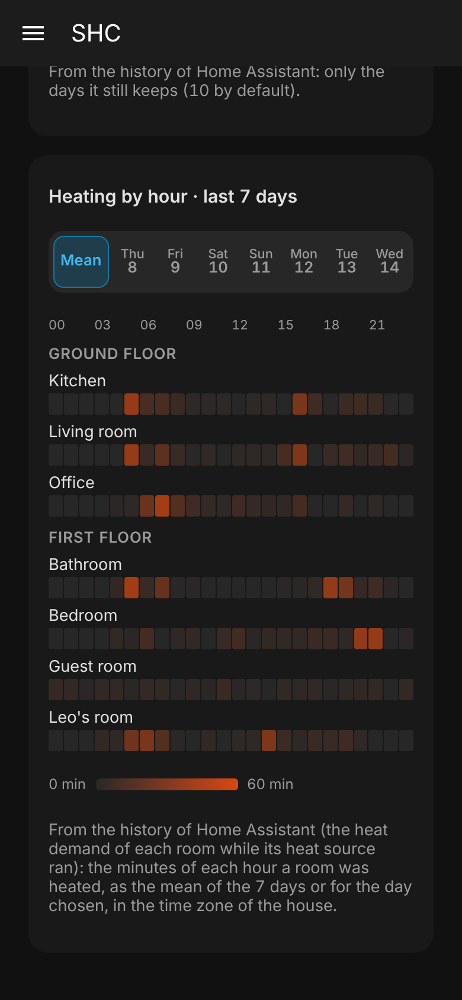</td>
  </tr>
</table>

<p align="center"><sub>En el móvil · personas y datos inventados</sub></p>

## Primeros pasos

[](https://my.home-assistant.io/redirect/hacs_repository/?owner=sandreialexandru&repository=Smart-Heating-Control&category=integration)

1. **Instala** desde el **Marketplace** (**Ajustes → Marketplace**, Home
   Assistant 2026.11 o posterior): busca **Smart Heating Control** e
   instálalo, o ábrelo con el botón de arriba; reinicia Home Assistant si te
   lo pide. Antes de la 2026.11 se hace igual en HACS, y después se reinicia.
   Sin ninguno de los dos, copia `custom_components/advanced_climate` en
   `config/custom_components` y reinicia.
2. **Añade la casa**: **Ajustes → Dispositivos y servicios → Añadir
   integración → Smart Heating Control**, o con este botón:

   [](https://my.home-assistant.io/redirect/config_flow_start/?domain=advanced_climate)

   Elige las personas y el termostato que calienta la casa: para una casa con
   un solo termostato ya has terminado.
3. **Añade las habitaciones** (opcional) con sus válvulas o sus termostatos,
   desde la página de la integración, y pon la tarjeta en un panel de control.

Requiere Home Assistant **2026.6.0** o posterior.

**¿No sabes qué elegir?** El
[configurador interactivo](https://github.com/sandreialexandru/Smart-Heating-Control/blob/main/docs/configurator.html)
(en inglés o rumano) empieza por lo que calienta tu casa y rellena las
respuestas adecuadas, recorre cada formulario, explica cada opción con lo que
cambia y un ejemplo, y termina con un resumen de lo que hay que ajustar y de
los problemas encontrados (como un dispositivo en dos funciones). Descarga el
archivo y ábrelo en un navegador.

## Documentación

La documentación está en inglés y en rumano.

| Documento | Qué contiene |
|---|---|
| [Guía](docs/guide/README.md) | Paso a paso, en palabras sencillas: cada ajuste, cada tipo de calefacción, ejemplos |
| [Probado con](docs/tested-with.md) | Los dispositivos confirmados por los usuarios |
| [Cómo aprende la integración](docs/learning.md) | El modelo de la habitación, con ejemplos resueltos y simulaciones |
| [Referencia](docs/reference.md) | Cada regla, sensor, atributo, servicio y opción de la tarjeta, en detalle técnico |
| [Especificación](docs/SPEC.md) | La especificación completa |
| [Novedades](CHANGELOG.md) | Lo que ha cambiado, versión a versión |

## Preguntas e ideas

- Una pregunta sobre la configuración: en las [discusiones Q&A](https://github.com/sandreialexandru/Smart-Heating-Control/discussions/categories/q-a).
- Una idea o una petición de función: en las [discusiones Ideas](https://github.com/sandreialexandru/Smart-Heating-Control/discussions/categories/ideas), donde otros pueden votar. Cómo se deciden las peticiones: [CONTRIBUTING](CONTRIBUTING.md).
- Un error: una [issue](https://github.com/sandreialexandru/Smart-Heating-Control/issues/new/choose).
- Las nuevas versiones: en los [Announcements](https://github.com/sandreialexandru/Smart-Heating-Control/discussions/categories/announcements).

## Traducciones

Integración y tarjeta: inglés, rumano, alemán, neerlandés, francés, italiano
y español. Documentación: inglés y rumano.

Los textos en español son nuevos. ¿Algo suena raro o lo dirías de otra
manera? Ayúdanos en [este issue](https://github.com/sandreialexandru/Smart-Heating-Control/issues/12).

## Apoyo

Si Smart Heating Control te resulta útil, puedes invitarme a un café en
[Ko-fi](https://ko-fi.com/sandreialexandru). ¡Gracias!

## Licencia

MIT
