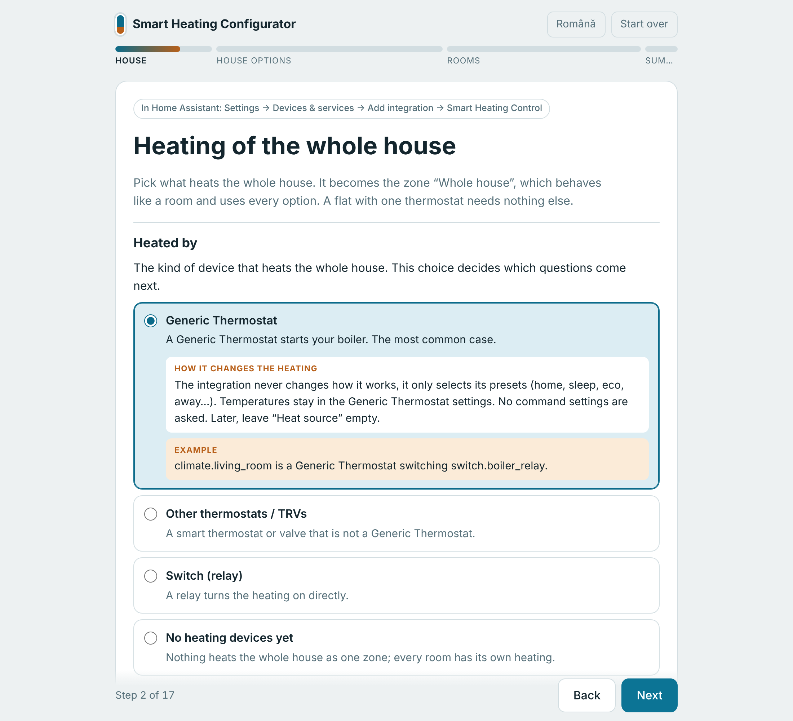

# Smart Heating Control

**English** | [Română](README.ro.md)

[](https://hacs.xyz/)
[](https://github.com/sandreialexandru/Smart-Heating-Control/actions/workflows/validate.yml)
[](https://github.com/sandreialexandru/Smart-Heating-Control/actions/workflows/tests.yml)

☕ **Like Smart Heating Control? Support its development:**

[](https://ko-fi.com/sandreialexandru)

**Heating for Home Assistant that knows who is home, learns how every room
heats and tells you why it does what it does.**

Warm when you get home, cool when nobody is there, never wasting heat on an
open window, and no rules to write. It works with what you already have:
Generic Thermostat, TRVs, smart thermostats or a plain relay.

https://github.com/user-attachments/assets/31181198-e0fa-4510-bbfa-af9f790a19c7

<p align="center"><sub>The card in use · invented people and data</sub></p>

## ✨ What it does

🏠 **Knows who is home.** Every person is *home*, *nearby* (somewhere in your
town) or *far*. The house heats for whoever is there, keeps *eco* while you
are only nearby, goes to *away* when everyone is far, and, with Proximity
(recommended, with its direction) or a travel time sensor, starts heating
again when someone is on the way back.

🧠 **Learns every room by itself.** Each room learns how fast it warms, how it
cools, how slowly its radiators or floor react, how a boiler with a weather
curve gives more in the cold and, with a weather entity, how much the sun
warms it. Then it starts heating just early enough to be warm on time, and
stops early when the room will stay comfortable anyway. Nothing to set: a
room needs about a day, 4 hours with heating and 4 without.

📅 **Schedules that fit your week.** Profiles for workdays, weekends, single
days or holidays (from the Workday integration), a calendar that picks the
profile of a day, or an existing Schedule helper. Edit them in the card by
dragging the times.

🪟 **Open windows and manual changes, handled.** A window sensor or a sudden
temperature drop lowers the heating; neighbouring rooms can follow. Turn a
thermostat by hand and the change is kept for as long as you chose, then the
schedule comes back.

🌦️ **Weather aware.** Turns the heating off when it is warm outside (also from
the forecast), keeps a heating season, adds heat in hard frost, and lowers a
sunny room.

⚡ **Energy.** Starts the boiler only when a room needs it, follows a dynamic
tariff or solar surplus, and counts the heating time per day, week or month.

🛡️ **Safe.** Frost protection always, a maximum temperature, every command
checked and sent again if it did not arrive, alerts for open windows,
unavailable devices, low batteries and **mold risk** at the coldest wall, and
a weekly valve exercise for TRVs.

🔍 **Explains itself.** Every room has a *Decision* sensor with the rule that
won and why, an event on every change, and diagnostics with the last 100
decisions.

🧩 **Fits your house.** Generic Thermostat (only the preset is chosen; your
thermostat keeps working as before), TRVs with calibration from a room sensor,
other thermostats, relays. °C or °F per house. English and Romanian.

## 🖼️ The card

A Lovelace card comes with the integration and is added to the dashboard
resources by itself.

<table>
  <tr>
    <td align="center" width="50%"><br><sub>The house and its rooms</sub></td>
    <td align="center" width="50%"><br><sub>What a room learned</sub></td>
  </tr>
  <tr>
    <td colspan="2" align="center"><br><sub>7 days of history and the next 12 hours, with the temperature the room expects</sub></td>
  </tr>
  <tr>
    <td align="center"><br><sub>Set a level or a temperature for a while</sub></td>
    <td align="center"><br><sub>Compact: one tile per room</sub></td>
  </tr>
</table>

```yaml
type: custom:smart-heating-control-card
```

Every part can be hidden; the options are in the [guide](docs/guide/10-card.md).

## ✅ Tested with

Smart Heating Control works with any `climate`, `switch` or temperature
`sensor` entity of Home Assistant, whatever the brand. These are the devices
users have confirmed so far:

| Device | Used as |
| --- | --- |
| Sonoff TRVZB (Zigbee2MQTT) | TRVs commanded by temperature, with *Offset* or *External temperature* calibration from a room sensor (*External temperature* needs `temperature_sensor_select` set to external in Zigbee2MQTT) |
| Zigbee TRVs (several per room) | TRVs commanded by temperature |
| Hive thermostat (local, Zigbee) | Heat source that starts the boiler |
| Shelly relay | Heat source (the boiler relay) |
| Tuya Zigbee dry contact (TS0001) | Heat source, through a template switch (it shows up as a `light`) |
| Generic Thermostat | Heating of the whole house, or a room |
| Xiaomi temperature sensor | Room sensor (also for the TRV calibration) |

Using it with another device? Tell us in an
[issue](https://github.com/sandreialexandru/Smart-Heating-Control/issues), so
it can be added here.

## 🚀 Get started

[](https://my.home-assistant.io/redirect/hacs_repository/?owner=sandreialexandru&repository=Smart-Heating-Control&category=integration)

1. **Install** from HACS (the **Marketplace** from Home Assistant 2026.11):
   search for **Smart Heating Control**, install it and restart Home
   Assistant. Not found in the search? Open it with the button above, or add
   it by hand: ⋮ → **Custom repositories** →
   `https://github.com/sandreialexandru/Smart-Heating-Control` as
   **Integration**. Without HACS, copy `custom_components/advanced_climate`
   into `config/custom_components`.
2. **Add the house**: **Settings → Devices & services → Add integration →
   Smart Heating Control**, or this button:

   [](https://my.home-assistant.io/redirect/config_flow_start/?domain=advanced_climate)

   Pick the people, the thermostat that heats the house, and you are done
   for a house with one thermostat.
3. **Add rooms** (optional) with their own valves or thermostats, from the
   integration page, and put the card on a dashboard.

Requires Home Assistant **2026.6.0** or newer.

<a href="https://github.com/sandreialexandru/Smart-Heating-Control/blob/main/docs/configurator.html"></a>

**Not sure what to pick?** The [interactive configurator](https://github.com/sandreialexandru/Smart-Heating-Control/blob/main/docs/configurator.html)
starts with what heats your home and fills in the matching answers, then
walks through every form, in English or Romanian, explains each choice with
what it changes and an example, and ends with a summary of what to set and
the problems it found (such as one device in two roles).
Download the file and open it in a browser.

<br clear="right">

## 📚 Documentation

| Document | What it covers |
|---|---|
| 📖 [Guide](docs/guide/README.md) | Step by step, in plain words: every setting, every kind of heating, examples |
| 🧠 [How the integration learns](docs/learning.md) | The room model, with worked examples and simulations |
| 🔧 [Reference](docs/reference.md) | Every rule, sensor, attribute, service and card option, in technical detail |
| 📋 [Specification](docs/SPEC.md) | The full specification |
| 📝 [Changelog](CHANGELOG.md) | What changed, version by version |

## 🌍 Translations

English and Romanian: the integration, the card and the documentation.

## ☕ Support

If Smart Heating Control is useful to you, you can buy me a coffee on
[Ko-fi](https://ko-fi.com/sandreialexandru). Thank you!

## License

MIT
