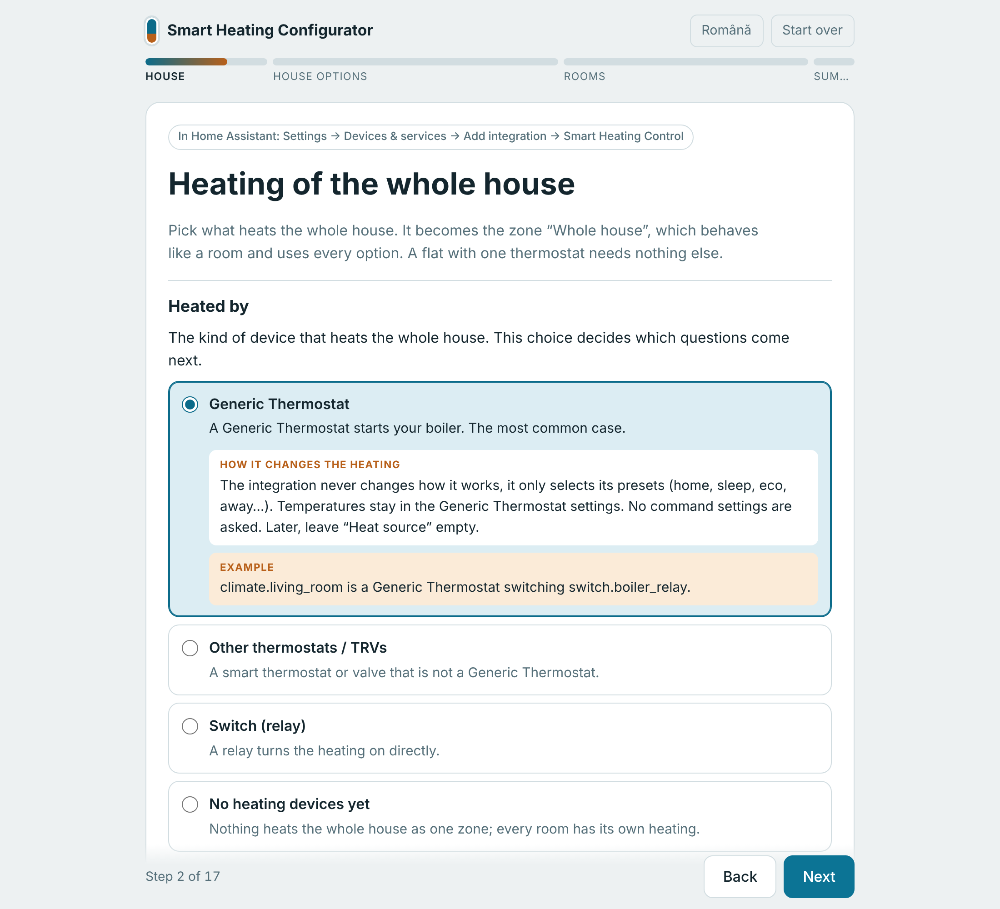

# Smart Heating Control

[English](README.md) | **Română**

[](https://hacs.xyz/)
[](https://github.com/sandreialexandru/Smart-Heating-Control/actions/workflows/validate.yml)
[](https://github.com/sandreialexandru/Smart-Heating-Control/actions/workflows/tests.yml)
[](https://ko-fi.com/sandreialexandru)

**Încălzire pentru Home Assistant care știe cine e acasă, învață cum se
încălzește fiecare cameră și spune de ce face ce face.**

Cald la venirea acasă, mai rece când nu e nimeni, fără căldură irosită pe o
fereastră deschisă și fără reguli de scris. Funcționează cu ce există deja:
Generic Thermostat, TRV-uri, termostate inteligente sau un simplu releu.

https://github.com/user-attachments/assets/31181198-e0fa-4510-bbfa-af9f790a19c7

<p align="center"><sub>Cardul în folosire · persoane și date inventate</sub></p>

## ✨ Ce face

🏠 **Știe cine e acasă.** Fiecare persoană e *acasă*, *aproape* (undeva în
oraș) sau *departe*. Casa încălzește pentru cine e acolo, ține *eco* cât
cineva e doar aproape, trece pe *away* când toți sunt departe și, cu Proximity
(recomandat, cu direcția) sau cu un senzor de timp de drum, pornește din nou
încălzirea când cineva e pe drum spre casă.

🧠 **Învață singură fiecare cameră.** Fiecare cameră învață cât de repede se
încălzește, cum se răcește, cât de încet reacționează caloriferele sau
pardoseala, cât dă în plus la ger o centrală cu curbă de temperatură și, cu o
entitate meteo, cât o încălzește soarele. Apoi pornește încălzirea exact cât
de devreme trebuie ca să fie cald la timp și o oprește mai devreme când camera
rămâne oricum confortabilă. Nu se setează nimic: unei camere îi trebuie circa
o zi, 4 ore cu încălzire și 4 fără.

📅 **Programe după săptămâna fiecăruia.** Profiluri pentru zile lucrătoare,
weekend, zile anume sau sărbători (din integrarea Workday), un calendar care
alege profilul unei zile sau un helper Program existent. Se editează în card,
prin tragerea orelor.

🪟 **Ferestre deschise și modificări manuale, rezolvate.** Un senzor de
fereastră sau o scădere bruscă a temperaturii reduce încălzirea; camerele
vecine pot urma. O modificare făcută de mână pe termostat se păstrează cât
s-a ales, apoi revine programul.

🌦️ **Ține cont de vreme.** Oprește încălzirea când e cald afară (și după
prognoză), păstrează un sezon de încălzire, adaugă căldură la ger și coboară
ținta unei camere însorite.

⚡ **Energie.** Pornește centrala doar când o cameră are nevoie, urmează un
tarif dinamic sau surplusul fotovoltaic și numără timpul de încălzire pe zi,
săptămână sau lună.

🛡️ **Sigură.** Antiîngheț mereu, o temperatură maximă, fiecare comandă
verificată și trimisă din nou dacă n-a ajuns, alerte pentru ferestre deschise,
dispozitive indisponibile, baterii descărcate și **risc de mucegai** la
peretele cel mai rece, plus mișcarea săptămânală a robinetelor TRV.

🔍 **Se explică singură.** Fiecare cameră are un senzor *Decizie* cu regula
care a câștigat și motivul, un eveniment la fiecare schimbare și un diagnostic
cu ultimele 100 de decizii.

🧩 **Se potrivește casei.** Generic Thermostat (se alege doar presetul;
termostatul funcționează la fel ca înainte), TRV-uri cu calibrare după un
senzor din cameră, alte termostate, relee. °C sau °F pe casă. Română și
engleză.

## 🖼️ Cardul

Integrarea vine cu un card Lovelace, adăugat singur la resursele
dashboard-ului.

<table>
  <tr>
    <td align="center" width="50%"><br><sub>Casa și camerele</sub></td>
    <td align="center" width="50%"><br><sub>Ce a învățat o cameră</sub></td>
  </tr>
  <tr>
    <td colspan="2" align="center"><br><sub>7 zile de istoric și următoarele 12 ore, cu temperatura pe care o așteaptă camera</sub></td>
  </tr>
  <tr>
    <td align="center"><br><sub>Un nivel sau o temperatură pentru o vreme</sub></td>
    <td align="center"><br><sub>Compact: o placă pe cameră</sub></td>
  </tr>
</table>

```yaml
type: custom:smart-heating-control-card
```

Orice parte se poate ascunde; opțiunile sunt în [ghid](docs/guide/10-card.ro.md).

## 🚀 Primii pași

[](https://my.home-assistant.io/redirect/hacs_repository/?owner=sandreialexandru&repository=Smart-Heating-Control&category=integration)

1. **Instalare** din HACS (**Marketplace** din Home Assistant 2026.11): se
   caută **Smart Heating Control**, se instalează și se repornește Home
   Assistant. Nu apare la căutare? Se deschide cu butonul de mai sus sau se
   adaugă de mână: ⋮ → **Custom repositories** →
   `https://github.com/sandreialexandru/Smart-Heating-Control` ca
   **Integration**. Fără HACS, se copiază `custom_components/advanced_climate`
   în `config/custom_components`.
2. **Casa**: **Settings → Devices & services → Add integration → Smart Heating
   Control**, sau acest buton:

   [](https://my.home-assistant.io/redirect/config_flow_start/?domain=advanced_climate)

   Se aleg persoanele și termostatul care încălzește casa; pentru o casă cu
   un singur termostat, asta e tot.
3. **Camerele** (opțional), cele cu robinete sau termostate proprii, se adaugă
   din pagina integrării, iar cardul se pune pe un dashboard.

Necesită Home Assistant **2026.6.0** sau mai nou.

<a href="https://github.com/sandreialexandru/Smart-Heating-Control/blob/main/docs/configurator.html"></a>

**Nu e clar ce trebuie ales?** [Configuratorul interactiv](https://github.com/sandreialexandru/Smart-Heating-Control/blob/main/docs/configurator.html)
începe cu ce încălzește locuința și completează răspunsurile potrivite, apoi
trece prin fiecare formular, în română sau engleză, explică fiecare alegere cu
ce schimbă și un exemplu și se încheie cu un rezumat a ce trebuie setat și cu
problemele găsite (de exemplu un dispozitiv cu două roluri).
Fișierul se descarcă și se deschide într-un browser.

<br clear="right">

## 📚 Documentație

| Document | Ce conține |
|---|---|
| 📖 [Ghid](docs/guide/README.ro.md) | Pas cu pas, pe înțelesul tuturor: fiecare setare, fiecare fel de încălzire, exemple |
| 🧠 [Cum învață integrarea](docs/learning.ro.md) | Modelul camerei, cu exemple calculate și simulări |
| 🔧 [Referință](docs/reference.ro.md) | Fiecare regulă, senzor, atribut, serviciu și opțiune a cardului, în detaliu tehnic |
| 📋 [Specificație](docs/SPEC.ro.md) | Specificația completă |
| 📝 [Changelog](CHANGELOG.md) | Ce s-a schimbat, versiune cu versiune (în engleză) |

## 🌍 Traduceri

Română și engleză: integrarea, cardul și documentația.

## ☕ Susținere

Dacă Smart Heating Control e de folos, proiectul poate fi susținut cu o cafea
pe [Ko-fi](https://ko-fi.com/sandreialexandru). Mulțumesc!

## Licență

MIT
