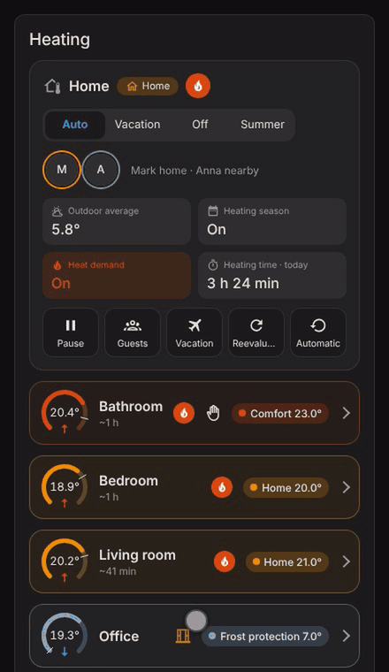
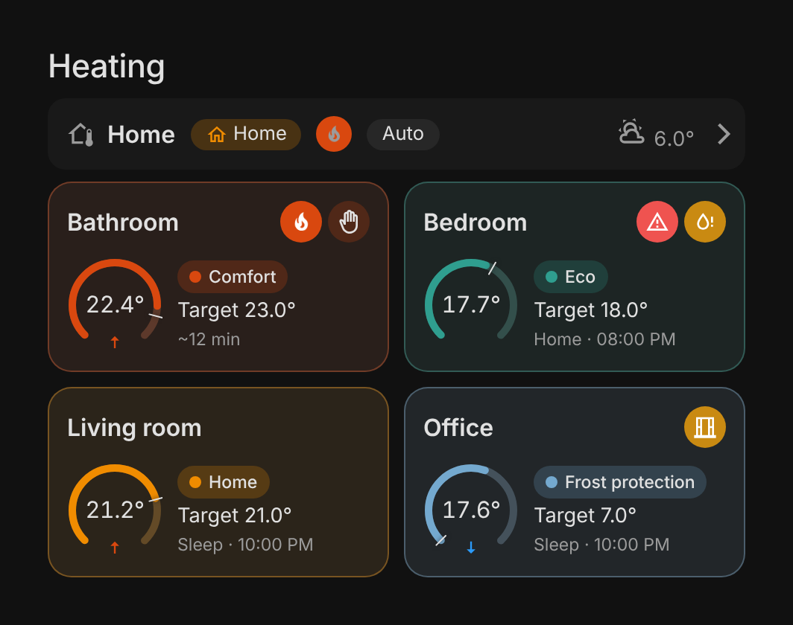
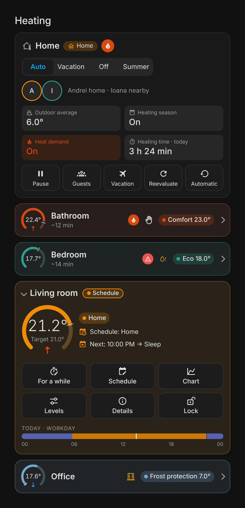
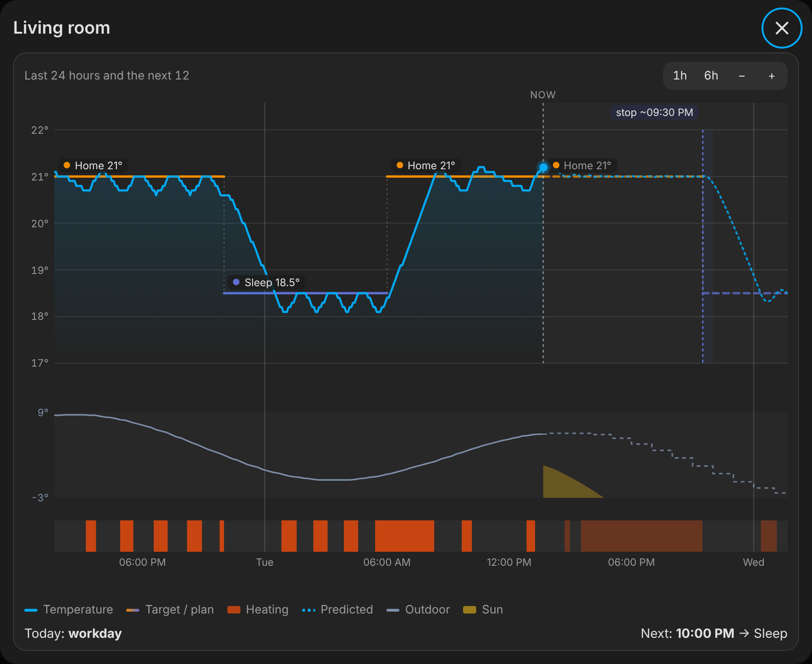
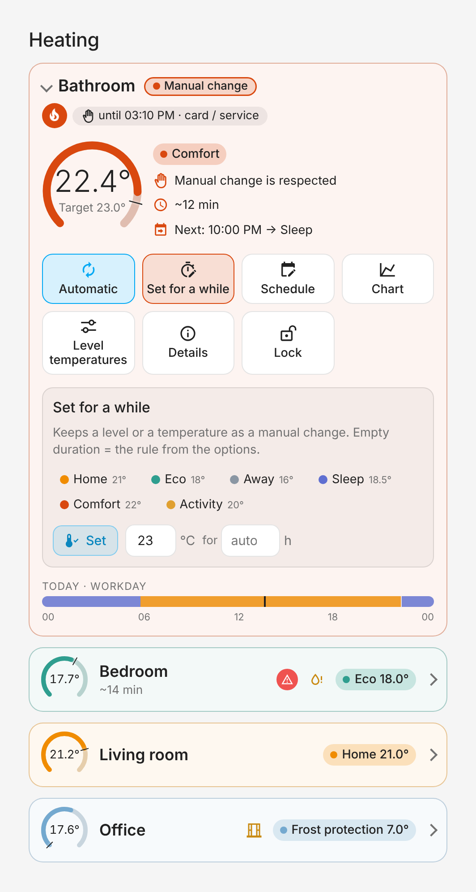
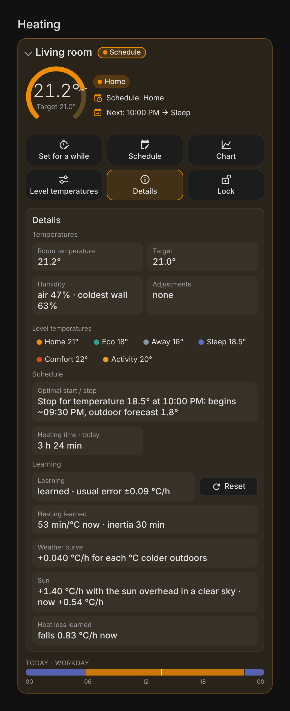

# 10. The card

*[Română](10-card.ro.md) · [Contents](README.md)*

The integration has a Lovelace card with every control: the house, the rooms,
the chart, the editable schedule and the details.

<p align="center"><br><sub>▶️ <a href="https://github.com/user-attachments/assets/31181198-e0fa-4510-bbfa-af9f790a19c7">The whole video (30 s, MP4)</a> · invented data</sub></p>

## Adding the card

The integration adds the card to the dashboard resources by itself (the address
`/advanced_climate/smart-heating-control-card.js?v=<version>`, changed with every
version, so the browser and the app load the new one). With YAML-mode
dashboards, add the address yourself as a resource of type `module`.

In a dashboard: **Add card → Smart Heating Control**. It has a visual editor.
Without any option it shows every house and room:

```yaml
type: custom:smart-heating-control-card
```

## Card options

| Option | Default | What it does |
| --- | --- | --- |
| `title` | Heating | The card title (an empty text hides it). |
| `rooms` | all | The list of the room *Decision* sensors to show. |
| `show_house` | `true` | The house part (see below). |
| `show_rooms` | `true` | The rooms. |
| `show_timeline` | `true` | The **Chart** button of every room (the chart opens with it). |
| `show_quick_override` | `true` | *Set for a while*. |
| `show_levels` | `true` | The level temperatures. |
| `show_details` | `true` | The room *Details*. |
| `show_schedule_editor` | `true` | The schedule editor. |
| `collapsed` | `false` | Rooms start folded (one row: a small arc, the name, the time to target, the state icons, the level and the target); tap it to open the room. |
| `compact` | `false` | One tile per room (the name, the state icons, arc with the temperature, level, target) and one row for the house; tap to open. |
| `runtime_period` | `day` | The heating time per `day`, `week` or `month` (calendar periods, from the long-term statistics); also changed by tapping the value in the card. |

**Example**: a card only for the bedroom, folded, without the schedule editor:

```yaml
type: custom:smart-heating-control-card
title: Bedroom
show_house: false
rooms:
  - sensor.bedroom_decision
show_schedule_editor: false
collapsed: true
```

<p align="center"></p>

## The house part

<p align="center"></p>

- The **flame** next to the presence (see below) while the house asks for heat;
  it flickers while a room of the house really heats.
- The **title** is the same in every view: the house icon and name, the
  presence (Home / Nearby / Away) and the flame.
- **Presence**, with every person as a round badge (the photo or the initial)
  in the colour of where they are: orange home, green nearby, grey far.
- Tiles for **the outdoor average** (over the *Average over* hours), the
  **season**, the **heat demand** and the **heating time**: two by two on a
  narrow card (three in a row without the heating time), all in one row on a
  wide one.
- The **mode** (Auto / Vacation / Off / Summer).
- A row of buttons: **Pause** and **Guests** (on / off), **Vacation** (opens
  the vacation dates), **Reevaluate** and **Automatic** (clears all manual
  changes). A button stays coloured while its mode is on.
- **Warm outside**, while the heating is off because it is warm, with the reason
  (measured average or forecast) or when the forecast lets the heating run (see
  [chapter 6](06-weather.md)). Not shown where it cannot act: mode Off or Summer,
  outside the season, in a pause.
- A **pause band** at the top while the house is paused, and a **guest band**
  while guest mode is on (with its end, when it has one).
- In the compact card the folded house row shows the people, the presence
  (Home / Nearby / Away), the mode, the outdoor temperature and a flame while
  there is heat demand.

## A room

The header shows the name, the decision (e.g. *Nearby*, *Schedule*; in the
colour of the level) and the flame, open window and manual change badges, and
*Mold risk* (a drop) while the mold risk alert of the room is active.

A **flame** shows the heat everywhere (house, open room, folded row, compact
tile): an outlined circle while there is a demand for heat (*Asks for heat*), a
full one that flickers while the heat source really runs (*Heating*); the words
appear when it is touched or hovered.

A folded room (row or compact tile) shows only the **level** (e.g. *Eco*) and
small icons: heating (flame), window open, mold risk (a drop, while its alert
is active), manual change and guest mode while it is on; the decision appears when the room is open, with the level next to
the arc. Under the name, the compact tile shows the time to the target while
the room heats, else the next change (e.g. *Sleep · 22:00*). Below the
header:

- an **arc** with the room temperature and the target under it; the arc is
  empty at the frost protection and full at the maximum temperature of the room
  (it only shows the temperature, it does not change anything); a short mark
  across the arc shows the target on the same scale (also on the small arcs);
  an **arrow** in the opening of the arc (also on the small arcs) shows that
  the room is warming (↑) or cooling (↓): a change of at least 0.2 °C per hour
  over the last 30 minutes, one step of a usual sensor (0.1 °C) in 30 minutes;
  no arrow while it is steady or not known yet (the `temperature_trend`
  attribute of the *Decision* sensor);
- next to it the **reason** (in the card language), the **time to target**
  (e.g. *~35 min*) or, during an optimal stop, the **expected temperature at
  the change** (*~21.5° at 22:00*), guest mode while it is on, **By the room sensor** when it is on for the
  room, and what the device itself measures (rooms with TRVs / climate
  devices);
- **Today**: the profile of the day as a bar over the schedule day (from the
  house *Schedule day starts at*, e.g. 00 → 24 or 04 → 04), with the time now.
If a room below its target does not heat, the card says why (*Not heating: …*,
see [chapter 8](08-heat-source-and-energy.md#when-a-room-below-its-target-does-not-heat)).
While there is a manual change, an **Automatic** button first in the row of
buttons under the arc clears it (back to automatic).

Under the arc, buttons open the sections **For a while** (*Set for a while*),
**Schedule**, **Chart**, **Levels** (*Level temperatures*) and **Details**, each on its own (several can be open at once); an
open section's button stays coloured. A **Lock** button next to them turns the
child lock of the room on or off (coloured while on). The chart and the
sections:

### The chart

<p align="center"></p>

Opened with the **Chart** button in a window over the dashboard, so it has room
(its history is loaded only then); one room at a time. It closes with the ✕, a
click outside it or Esc, and when another dashboard view is opened. It keeps **7 days** of history and the next 12 hours,
and opens on the last 24 hours and the next 12:

- the room temperature;
- the **predicted temperature** ahead (dotted), once the room has learned: the
  learned model of the room (heating, weather curve, heat loss, sun, inertia)
  simulated minute by minute along the planned target, with the hourly
  forecast. The heating is switched as the device does it: Generic Thermostat
  by its *cold* and *hot tolerance*, relays, on / off control and heating
  by the room sensor by the hysteresis (and the learned inertia when it is on), thermostats
  without `hvac_action` by the hysteresis. So the line goes up and down around
  the target as the room really does. Thermostats and TRVs commanded by
  temperature or preset that report `hvac_action` regulate by themselves: for
  them, and for a Generic Thermostat set up in YAML (its tolerances cannot be
  read), the line holds the target and the heating ahead is one lighter period
  ("it heats as much as it needs");
- the target, as a step line, coloured by level;
- the planned levels;
- the periods the room heated, in a lane of their own, and ahead, lighter, the
  periods the prediction heats;
- a fine line at every midnight, between the days;
- the outdoor temperature in its own band (measured, then the hourly forecast
  dashed) and the cutoff as a dotted line;
- the **sun** expected ahead, as a faint yellow area at the bottom of the
  outdoor band (from nothing to the full sun: overhead in a clear sky), once
  the room has learned that the sun warms it;
- the next optimal start / stop, as a shaded period.

Every item of the legend under the chart hides or shows its series when
tapped (crossed out while hidden); the choice is kept in this browser for all
the charts.

Values are read with the mouse, by tapping or by dragging on the chart, in an
opaque box (also with themes whose cards are transparent). Zoom with the
buttons (1h, 6h, −, +), double click, pinch or Ctrl + wheel, from 20 minutes up
to the 7 days; **⤢** goes back to the last 24 hours and the next 12. Move through
the history by dragging the window in the **navigation bar** below the chart, or
by scrolling sideways (a touchpad, or Shift + wheel). The navigation bar shows
while the mouse is over the chart, or while a finger is on it and for a moment
after, then hides again.

The planned part shows what will happen: the schedule; a manual change with a
duration until its end; a planned vacation until the preheating; a calendar
event until its end. A window, frost protection or the valve exercise appear
only for now. Mode Off / Summer, the pause, being away, failed sensors and *Warm
outside* appear as they are now, for the whole period.

### Set for a while

<p align="center"></p>

Set a level or a temperature for a number of hours: *[Set] [21] °C for [2] h*.
Empty hours = the configured rule for manual changes. A manual change with an
end shows the time it has left, e.g. *until 15:10 · 1 h 30 min left* (in
5-minute steps above an hour).

### Levels

The level temperatures (rooms without Generic Thermostat) and the fixed nearby
temperature. Changed right from the card, between the frost protection and the
maximum.

### Schedule

Every profile with its days and an on / off switch:

- **start times** are dragged on the day bar, in 5-minute steps, or typed (or
  picked) in the time field of each row: the bar follows at once, and the rows
  are sorted again when you leave the field;
- the **level** of each start is picked in the list next to it;
- the **days** are chosen in the editor (all, workdays, weekend, chosen days);
- a profile can be **copied** over another;
- the card warns before turning a profile on or off would leave days without a
  profile (which would stay on frost protection).

### Details

<p align="center"></p>

In groups:

- the **alerts** of the room and the house, first;
- **Temperatures**: the room, the target, the thermostat preset, the
  **humidity** (with a humidity sensor: of the air and at the coldest wall,
  marked *mold risk* from 80 %), the active adjustments, the level temperatures;
- **Schedule**: the next optimal start / stop, the heating time;
- **Learning**: its state (*learned* with the usual error of the model, or,
  while learning, two bars with the hours seen with and without heating out of
  the 4 needed, with the default under them) with a **Reset** button (with a
  second click to confirm); once learned, one tile each for the **heating**
  (minutes per degree now, e.g. *45 min/°C*), the **inertia** (e.g. *30 min*),
  the **weather curve** (e.g. *+0.050 °C/h for each °C colder outdoors*, or
  *none*), the **sun** (once learned) and the **heat loss** (how fast the room
  falls now);
- **Devices**: every entity of the room (thermostats, relays, temperature and
  humidity sensors, windows, occupancy, calibration) with its role and its
  state now (*20.4° → 21.0° heating*, *open*, *55 %*); one that is
  *unavailable*, *unknown* or *not found* is marked. A tap opens its dialog.

With a manual change, the card shows where it was made (card / service or on the
device), until when, *applies after: …* or *returns after: …*.

Almost every value, state or badge opens the entity's more-info dialog when
tapped.

## Times

Times (chart, schedule bar, until when, vacation dates) follow the *Time zone*
setting of your Home Assistant profile: the device's, or the server's when you
chose that. Vacation dates are sent with their time zone, so they mean the same
moment on the server.

## Language

The card is in English and Romanian, following the Home Assistant language. The
decision reason and the adjustment names are translated (the *Decision* sensor
has them as `reason_key` and `reason_params`; `reason` stays the English text).
